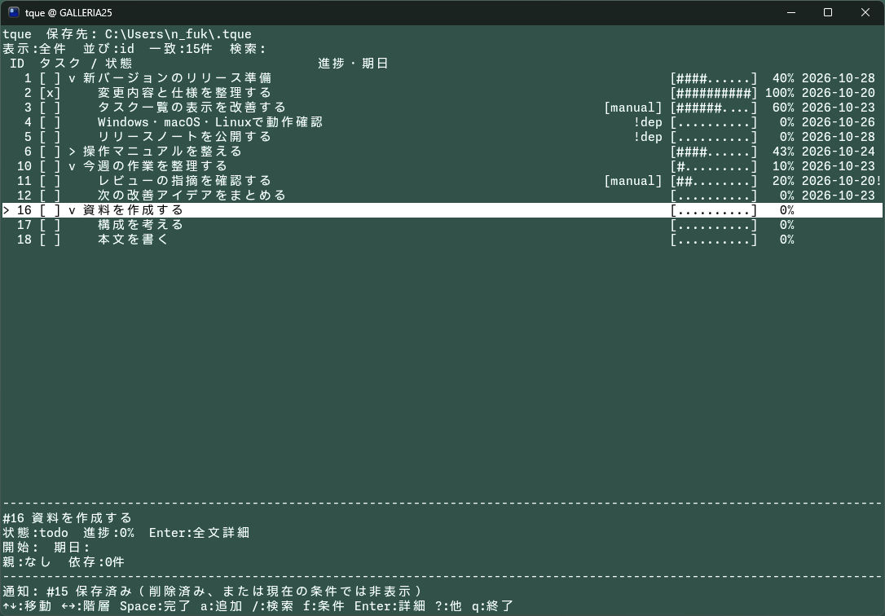
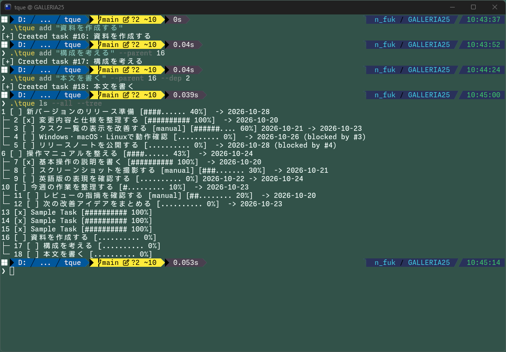

# tque

[English](README.md) | [日本語](README.ja.md)

CLIとTUIを一つの実行ファイルにまとめたタスク管理アプリです。親子関係、依存先、開始日・期日、手動／自動進捗を管理します。

現在は初期実装です。OSごとの実行検証、署名、配布準備の状態は [実装・検証記録](docs/implementation-status.md) を参照してください。

導入後の操作、コマンド一覧、保存先の変更、トラブル時の対処は [利用マニュアル](docs/user-manual.ja.md) にまとめています。

Windows版の対象はWindows 11です。インストーラーはビルド22000以上を要求し、Windows 10にはインストールできません。

## スクリーンショット

TUIでは、親子関係・進捗・期日・依存待ちを一覧で確認できます。



CLIからタスクを追加し、ツリー形式で一覧を表示する例です。



## ビルドと起動

```powershell
# Windows / PowerShell
go test ./...
go vet ./...
./scripts/build-release.ps1 -OutputDirectory ./.work/build
./.work/build/tque-windows-amd64.exe
```

```sh
# macOS / Linux（Goを導入済みの環境）
go test ./...
go vet ./...
bash scripts/build-release.sh "$(go env GOOS)" "$(go env GOARCH)" ./.work/build
./.work/build/tque-$(go env GOOS)-$(go env GOARCH)
```

`go.mod`のtoolchainはGo 1.27.3です。ビルド時に必要なツールチェーンと依存を取得します。実行時にGo、PowerShell、外部DBは不要です。

## CLI

実行ファイルをPATHの通った場所へ配置した場合の例です。例のIDは、追加時に表示された実際のIDに読み替えてください。

表示用IDの付け直しは `tque renumber 8 6`（TUIでは `i`）で行います。変更先にタスクがあれば間の番号を1つずらし、親子・依存関係は固定の内部IDで維持します。schema 2のデータは読み込みだけでは書き換えず、初回の内容変更時に原本を `tasks.schema2.backup` に残してschema 3へ移行します。旧版はschema 3を読み込めません。

```text
tque add "リリース準備" --due +7d
tque add "保存処理を実装" --parent 1 -p 50
tque add "結合テスト" --parent 1 --dep 2
tque ls --all --tree
tque ls --search 保存 --sort due
tque ls --due-today
tque ls --ready --json
tque edit 2 -p auto
tque edit 2 --due none
tque done 2
tque undone 2
# 注意: 確認なしでタスク1とすべての子孫を削除
tque rm 1 --cascade
```

- `ls`は未完了のみ、`--all`で全件。`--due-today`は今日までの期日（期限超過を含む）です。
- `--dep 2,3 --dep 4`のように指定できます。編集時は依存先全体を置き換えます。
- `edit --parent/--dep/--start/--due none`で解除します。
- `--tree --json`、`--ready --blocked`の併用は引数エラーです。
- 進捗100%だけでは完了になりません。親の完了は子へ伝播しません。
- 自動進捗は直下の子の表示進捗の平均です。`[manual]`は手動固定です。
- 依存待ちは警告であり、編集や完了を禁止しません。外部のタスクから依存されているタスクの削除は拒否します。
- 終了コードは0が成功、1が業務・設定・保存エラー、2が引数エラー、3が保存結果不明です。3の場合は追加操作をそのまま再送せず、再読込して結果を確認してください。

`rm`は確認なしで削除し、Undoはありません。保存成功後のロック解放失敗では保存済みの結果と`saved; unlock failed`を表示して終了コード1を返します。再実行前にデータを確認し、追加を自動再試行しないでください。

## TUI

引数なし、または`--tui`で起動します。対話端末が必要です。

| キー | 操作 |
| --- | --- |
| 上下 / j・k | 選択移動 |
| 左右 | 折り畳み・展開・親子移動 |
| Enter / Esc | 全文詳細を開く／戻る |
| a / A | 親なしで追加／選択タスクの子を追加 |
| e / s / d / p / l | タイトル／開始日／期日／進捗／依存先を編集 |
| Space | 完了・未完了を切替 |
| + / - | 進捗を10ずつ変更し、手動固定 |
| x / Delete | 削除確認。yで実行、n・Esc・Enterで取消 |
| / | タイトル検索。入力中の左右は文字カーソル移動 |
| f | 全件→未完了→今日まで→期限超過→着手可能 |
| o | ID順・期日順・名前順を切替 |
| r | 保存データを再読込 |
| ? | 操作ヘルプ。保存先・最新通知の全文も確認可能 |
| q / Ctrl+C | 終了。入力中のqは文字として入力 |

属性入力はEnterで保存、Escで取消。日付・依存先の空欄は解除です。検索入力はEnterで条件を維持、Escで入力開始前へ戻ります。一覧のEscは検索だけを解除し、fの条件は維持します。

検索・絞り込み中は一致したタスクの祖先を`[context]`で残します。一致件数には祖先を含めません。`!dep`は依存待ち、期日末尾の`!`は未完了の期限超過です。詳細で未完了の依存先IDを確認できます。

保存は操作ごとに行います。保存中の更新入力は無視し、保存中はCtrl+Cだけが終了予約となり、成功が判明してから終了します。qは無視します。別プロセスと競合した場合は最新データを読み込み、編集案を保持して再確認を求めます。

## 保存先

3 OSとも設定ファイルは`~/.tque/config.json`、データの既定保存先は`~/.tque`です。アプリは設定ファイルを自動作成しません。

```json
{
  "data_dir": "~/tque-data"
}
```

Windowsの絶対パス例は`"D:/tque-data"`です。相対パスはconfig.jsonのあるディレクトリが基準です。環境変数は展開しません。不正な設定を既定値で代替せず、エラーで停止します。設定変更後は再起動してください。

保存ディレクトリには`tasks.json`、OSロック用の`lock`、更新前の1世代を保持する`tasks.json.backup`を置きます。読取だけではtasks.jsonを作りませんが、lockは読み書き用に開くか作成するため、その権限が必要です。ロックファイルは削除する必要がありません。ネットワーク共有・同期ソフトによる同時変更は保証対象外です。

保存先の変更でデータを自動移動しません。移行・バックアップ復旧時はすべてのtqueを終了し、revisionを含むドキュメント全体を保全してください。詳しい手順は [利用マニュアルの保存先・復旧手順](docs/user-manual.ja.md#保存先を設定する) を参照してください。

## GitHub ActionsでのZIP作成

`test-and-package`はブランチpush、`v*`タグのpush、pull request、手動実行で起動します。`VERSION`を検査し、Windows・macOS・Linuxでのテスト成功後、Ubuntu上で各OSのamd64／arm64向けに6種類のZIPを作成します。バージョンは`VERSION`から取得します。

```text
tque-0.2.4-windows-amd64.zip
tque-0.2.4-windows-arm64.zip
tque-0.2.4-darwin-amd64.zip
tque-0.2.4-darwin-arm64.zip
tque-0.2.4-linux-amd64.zip
tque-0.2.4-linux-arm64.zip
```

`darwin`はmacOSです。ZIP内の同名ディレクトリに、アプリ本体（Windowsは`tque.exe`、macOS/Linuxは`tque`）、英語・日本語のREADME、CHANGELOG、docs全体（両言語の操作マニュアル・設計／レビュー記録・検証記録・チェックリスト・設定例）、LICENSE、依存ライセンスを同梱します。Unixの実行権限はZIP内に保持します。

GitHubの **Actions → test-and-package → 成功した実行 → Artifacts** から対象を取得します。各ArtifactにはZIPと`.zip.sha256`チェックサムを含みます。ダウンロードするアーカイブの中に目的のZIPがあるため、中のZIPも展開してください。実行ファイルはランナーの一時ディレクトリでビルドし、リポジトリの`dist`には置きません。バージョンタグのpush時は、以下の手順でReleaseにも登録します。タグ作成や署名付きインストーラー作成は行いません。

### バージョンタグによるRelease公開

`VERSION`の値と同じ名前のタグをpushします。例えば`0.2.4`です。先に公開対象のソースとワークフロー変更をコミット・pushし、そのコミットへタグを付けてください。タグとVERSIONが不一致なら、テストやパッケージ作成の前に停止します。形式は`v`を付けない`MAJOR.MINOR.PATCH`で、プレリリース用の接尾辞には対応しません。

3 OSのテストと6対象すべてのパッケージ作成に成功した後、同じ実行のArtifactsを取得してZIPとSHA256を確認し、`tque 0.2.4`というタイトルのReleaseを公開します。説明はGitHubが自動生成します。添付はZIP 6個と`.zip.sha256` 6個で、リポジトリのReleasesから直接取得できます。これらはアプリ本体であり、署名付きインストーラーではありません。

公開するのは**タグのpush時だけ**です。ブランチpush・pull request・手動実行ではArtifactsの作成までに留めます。公開ジョブだけに組込み`GITHUB_TOKEN`の`contents: write`を付与し、個人アクセストークンは不要です。再実行しても既存Releaseを上書きしません。アップロードが失敗した場合は、残ったRelease／下書きと添付内容を確認してから再試行してください。タグの作成・pushは利用者が明示的に行います。[GitHub CLIのRelease作成仕様](https://cli.github.com/manual/gh_release_create)を参照しています。

本体の[MITライセンス](LICENSE)の著作権者は`fukuyori`です。ZIP作成に必要なLICENSEの条件は満たしています。クロスビルド成功と対象機での動作確認は別です。macOS・ARM64の実機動作は未確認です。

Actionsの設定は[setup-goのバージョンファイル指定](https://github.com/actions/setup-go/blob/main/docs/advanced-usage.md)と[upload-artifactの公式資料](https://github.com/actions/upload-artifact)を参照しています。

Goと`zip`を導入したUnix環境で、次のコマンドでスクリプトを確認できます。既存の同名ZIPは上書きしません。

```sh
bash scripts/package-zip.sh linux amd64 ./.work/packages
```

ローカル用の既存ビルドスクリプトの既定出力先は引き続き`dist`です。上記のビルド例とCIでは出力先を明示しています。ビルド・収集スクリプトに明示した相対出力先は、呼び出し時の作業ディレクトリを基準にします。ZIPの照合にはLinuxで`sha256sum -c NAME.zip.sha256`、macOSで`shasum -a 256 -c NAME.zip.sha256`を使えます。

## 補完

`tque completion powershell|bash|zsh|fish`でスクリプトを標準出力へ生成します。プロファイルは自動変更しません。

```powershell
tque completion powershell | Out-String | Invoke-Expression
```

```sh
# Bash: 現在のシェルで有効化
source <(tque completion bash)
# Zsh: 補完初期化後に読み込む
autoload -Uz compinit; compinit
source <(tque completion zsh)
# Fish
tque completion fish | source
```

## 配布用スクリプト

`build-release.ps1 -OS windows|darwin|linux -Arch amd64|arm64`、または`bash scripts/build-release.sh OS ARCH`で対象別にビルドします。クロスビルド成功は対象OSでの実行確認を意味しません。

配布物には`Copyright (c) 2026 fukuyori`を記載した本体の[LICENSE](LICENSE)を同梱します。パッケージ作成スクリプトはLICENSEの欠落や未確定のプレースホルダーを検査します。

[依存モジュール一覧](third-party-licenses/MODULES.txt)に取得対象のバージョンを記録し、対応するサブディレクトリに著作権表示とライセンス原文を保存しました。パッケージ作成時には、テスト用・ツール用の依存とサブディレクトリ内のライセンスを含め、モジュールグラフ全体から再取得します。特定の実行ファイルにリンクされる依存だけの一覧ではありません。

Windowsは`build-installer.ps1`でInno Setupを使用します。`-Sign`指定時は実行ファイル、インストーラー、アンインストーラーに署名します。`CODESIGN_CERT`はwtmuxと同じく**証明書ストア内の証明書のサブジェクト名**を指定し、`signtool /n`へ渡します。SignToolはWindows SDK（OSのネイティブアーキテクチャ優先、次にx64）またはPATHから検出します。RFC3161タイムスタンプURLの既定値もwtmuxと同じ`http://timestamp.sectigo.com`です。

```powershell
# CODESIGN_CERTに証明書のサブジェクト名を設定した環境で実施
./scripts/build-installer.ps1 -Sign
```

40桁のSHA1拇印で選ぶ場合は、`CODESIGN_CERT`に拇印を設定し、`-CertificateSelector Thumbprint`を追加してください。既定の選択方法は`SubjectName`で、証明書ファイルやPFXには対応しません。`-SignToolPath`／`-TimestampUrl`で検出先やタイムスタンプサービスを変更できます。CurrentUserの証明書ストアを既定とし、LocalMachineは`-MachineCertificateStore`を明示します。PowerShell 5.1と7で引数処理を確認済みですが、実際の署名とインストール・アンインストールは未検証です。設定・保存データはアンインストールで削除しません。`/n`と`/sha1`の指定方法は[MicrosoftのSignTool公式資料](https://learn.microsoft.com/en-us/windows/win32/seccrypto/signtool)を参照しています。

macOS/Linuxは`bash scripts/package-release.sh OS ARCH`でtar.gzとSHA256を作成します。ライセンス類を同梱します。macOSの署名・公証は別途対応が必要です。

macOS/Linuxで利用者の領域に配置する例:

```sh
mkdir -p "$HOME/.local/bin"
install -m 755 tque "$HOME/.local/bin/tque"
```

`~/.local/bin`がPATHにない場合は利用者がシェル設定へ追加してください。アプリはシェル設定を書き換えません。
